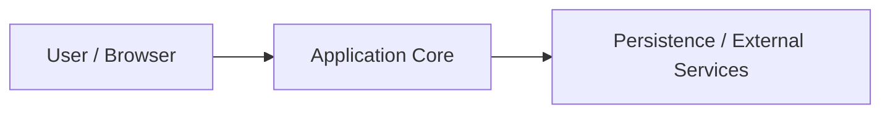

# System Architecture (`docs/ARCHITECTURE.md`)

> Living technical blueprint updated at the close of every Phase/Slice.

## 1. High-Level Diagram


## 2. Tech Stack & Runtime Choices
{{STACK_SUMMARY}}

## 3. Directory Structure
*Updated as modules are created.*

```text
.
├── AGENTS.md
├── .agents/
├── docs/
└── ...
```

## 4. Data Model, APIs & Security Boundaries
- **Stored Entities / Schema:** *Updated in Database/Schema phase*
- **External Inputs / APIs:** *Updated in API/Integration phases*
- **Security & Privacy Controls:** *Updated during Architecture & Security stages*
