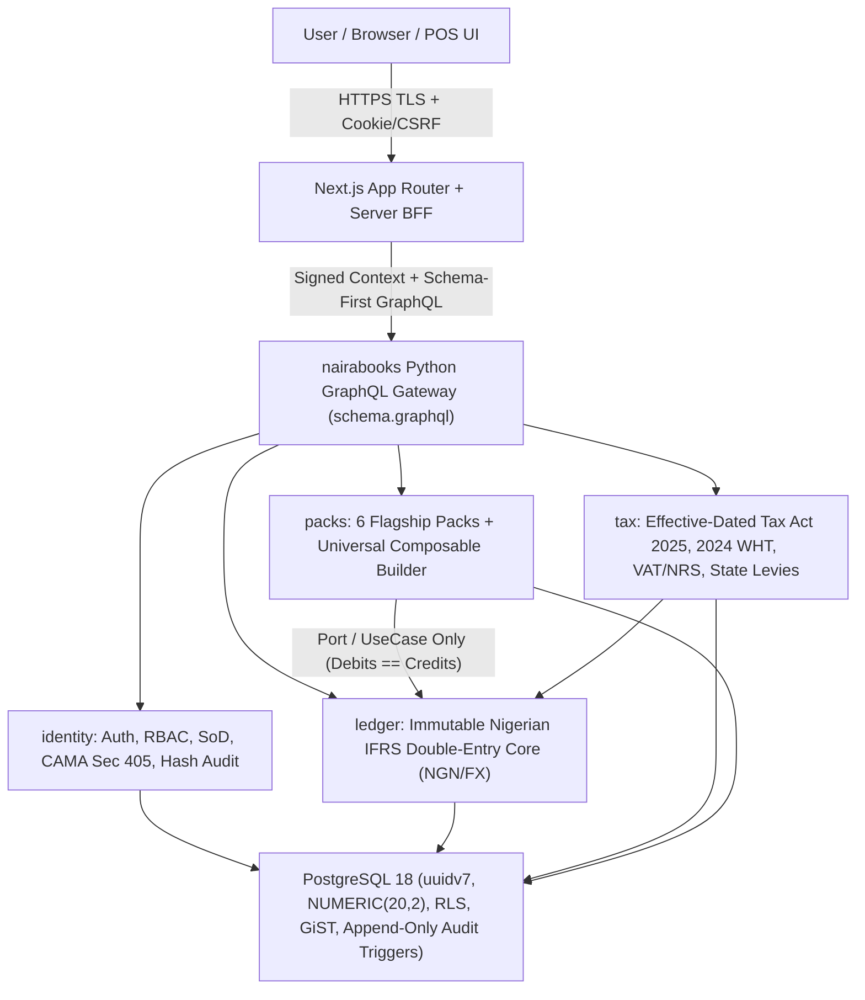

# System Architecture (`docs/ARCHITECTURE.md`)

> Living technical blueprint updated at the close of every Phase/Slice.
> Detailed architecture blueprints: [PHASE_3_ARCHITECTURE.md](./PHASE_3_ARCHITECTURE.md), [API_REFERENCE.md](./API_REFERENCE.md), [THREAT_MODEL.md](./THREAT_MODEL.md), [PHASE_4_DATABASE.md](./PHASE_4_DATABASE.md), [PHASE_5_DESIGN_SYSTEM.md](./PHASE_5_DESIGN_SYSTEM.md).

## 1. High-Level Diagram


## 2. Tech Stack & Runtime Choices
- **Core Backend Architecture (`ADR-006`):** Modular Monolith in `src/nairabooks/` with 5 Hexagonal Bounded Contexts (`ledger`, `tax`, `packs`, `identity`, `api`) and Transactional Outbox extraction seam *(Phase 3)*
- **GraphQL Contracts (`ADR-007`):** Schema-first SDL in `api/graphql/schema.graphql`, exact string scalars `DecimalMoney` / `DecimalRate` (zero `Float`), Relay cursor pagination, typed `MutationError` unions, `@requireRole` & `@cost` guards *(Phase 3)*
- **Threat Modeling (`ADR-008`):** STRIDE analysis, AND/OR Attack Trees, and `SEC-REQ-01`..`SEC-REQ-12` covering tenant isolation, `Decimal` math, immutability, SoD, and GraphQL DoS caps *(Phase 3)*
- **Relational SQL, Postgres 18 & Zero-Downtime Migrations (`ADR-009`):** `PostgreSQL 18.3` with `uuidv7()`, `NUMERIC(20,2)`/`NUMERIC(10,6)`, `btree_gist` `EXCLUDE`, Row-Level Security (`SET LOCAL`), DB-enforced double-entry balance & audit immutability triggers, keyset covering indexes, paired SQL rollbacks, `MigrationObserver` telemetry, & `pgoutput` CDC config *(Phase 4)*
- **UI/UX & Accessibility (`ADR-010`):** Google Stitch MCP visual prototypes (`projects/9422961334487487882`, `assets/8475106491343804798`) exported under `design/stitch/`, Tailwind CSS semantic `--nb-*` tokens (`design/tokens/nairabooks.tokens.json`, `design/tailwind.config.ts`, `design/globals.css`), Grav 16:9 illustrations (`design/illustrations/`), mathematical WCAG 2.2 Level AA contrast proofs (`>= 4.5:1` / `>= 3.0:1`), and assistive-tech priority matrix (`NVDA`, `VoiceOver`, `JAWS`, `TalkBack`) in `docs/PHASE_5_DESIGN_SYSTEM.md` *(Phase 5)*
- **Verified Runtime Baseline:** Python 3.11.0, `uv 0.12.9`, Node v24.14.1, npm 11.11.0, Git 2.53.0, PostgreSQL 18.3, Docker Compose v5.6.0 (`pyproject.toml` + `uv.lock`)

## 3. Directory Structure
*Updated as modules are created.*

```text
.
├── AGENTS.md
├── wizard-selection.json
├── pyproject.toml
├── uv.lock
├── README.md
├── .python-version
├── .env.example
├── .gitignore
├── .editorconfig
├── .vscode/
│   └── settings.json
├── api/
│   └── graphql/
│       └── schema.graphql
├── db/
│   ├── migrations/
│   │   ├── 0001_initial_core_schema.sql
│   │   ├── 0002_rls_and_ledger_invariants.sql
│   │   ├── 0003_indexes_and_observability.sql
│   │   └── rollbacks/
│   │       ├── 0001_rollback.sql
│   │       ├── 0002_rollback.sql
│   │       └── 0003_rollback.sql
│   └── queries/
│       └── frcn_and_tax_analytics.sql
├── .agents/
│   ├── skills.json
│   ├── rules/
│   └── skills/
├── conductor/
│   ├── index.md
│   ├── setup_state.json
│   ├── product.md
│   ├── product-guidelines.md
│   ├── tech-stack.md
│   ├── workflow.md
│   ├── tracks.md
│   ├── code_styleguides/
│   │   ├── python.md
│   │   └── typescript.md
│   └── tracks/
│       ├── nigerian-ifrs-core-ledger_20261112/
│       ├── nigerian-tax-rule-engine_20261112/
│       ├── composable-pack-engine_20261112/
│       ├── flagship-industry-packs_20261112/
│       ├── auth-rbac-audit-trail_20261112/
│       └── _archive/
├── src/
│   └── nairabooks/
│       ├── __init__.py
│       ├── py.typed
│       ├── config.py
│       ├── main.py
│       └── adapters/
│           ├── __init__.py
│           └── migrations.py
├── tests/
│   ├── __init__.py
│   ├── test_scaffold.py
│   ├── test_architecture_contracts.py
│   ├── test_database_schema.py
│   └── test_design_system.py
├── design/
│   ├── index.html
│   ├── preview/
│   │   └── index.html
│   ├── globals.css
│   ├── tailwind.config.ts
│   ├── tokens/
│   │   └── nairabooks.tokens.json
│   ├── illustrations/
│   │   ├── nairabooks-double-entry-flow.jpg
│   │   └── nairabooks-composable-packs.jpg
│   └── stitch/
│       ├── manifest.json
│       ├── screen-1-setup-business.{html,png}
│       ├── screen-2-overview-top-nav.{html,png}
│       ├── screen-3-books-hub.{html,png}
│       ├── screen-4-book-entry-form.{html,png}
│       ├── screen-5-journal-adjustments.{html,png}
│       ├── screen-6-directory-create.{html,png}
│       ├── screen-7-pdf-bank-reconcile.{html,png}
│       └── screen-8-reports-center.{html,png}
├── docs/
│   ├── WORKFLOW_PLAN.md
│   ├── SKILL_COVERAGE.md
│   ├── PHASE_0_SETUP.md
│   ├── PHASE_1_MARKET_VALIDATION.md
│   ├── PHASE_2_SPEC_FOUNDATION.md
│   ├── PHASE_3_ARCHITECTURE.md
│   ├── PHASE_4_DATABASE.md
│   ├── PHASE_5_DESIGN_SYSTEM.md
│   ├── API_REFERENCE.md
│   ├── THREAT_MODEL.md
│   ├── PRD.md
│   ├── ARCHITECTURE.md
│   ├── DECISIONS.md
│   ├── STAGE_LOG.md
│   ├── STATE.md
│   ├── SESSION_HANDOFF.md
│   └── USER_GUIDE.md
├── scripts/
│   ├── verify_workflow.py
│   ├── dx_check.py
│   └── validate_conductor.py
└── antigravity-dynamic-vibecode-kit/
```

## 4. Data Model, APIs & Security Boundaries
- **Stored Entities / Schema:** [`db/migrations/0001_initial_core_schema.sql`](../db/migrations/0001_initial_core_schema.sql)–`0003` and [`docs/PHASE_4_DATABASE.md`](./PHASE_4_DATABASE.md) define 16 tables across identity, effective-dated tax rules (`btree_gist`), pack manifests (`JSONB`), immutable double-entry ledger, period snapshots, CAMA Sec 405 sign-offs, audit events, and transactional outbox with manual FK indexes, covering keyset indexes, and paired rollback scripts.
- **External Inputs / APIs:** Schema-first GraphQL contract at [`api/graphql/schema.graphql`](../api/graphql/schema.graphql) documented in [`docs/API_REFERENCE.md`](./API_REFERENCE.md); Next.js BFF bridges browser HTTP-only cookies to signed internal GraphQL execution contexts.
- **Security & Privacy Controls:** [`docs/THREAT_MODEL.md`](./THREAT_MODEL.md) (`SEC-REQ-01`..`SEC-REQ-12`) enforced in DB via [`0002_rls_and_ledger_invariants.sql`](../db/migrations/0002_rls_and_ledger_invariants.sql): PostgreSQL RLS on all 11 tenant tables (`SET LOCAL app.current_workspace_id` compatible with PgBouncer transaction pooling), deferred double-entry balance trigger, and `BEFORE UPDATE OR DELETE` immutability triggers on `audit_events` and `POSTED`/`REVERSED` vouchers/lines.


---

## Implemented Module Inventory — Phase 6 Slice 1 (`2026-11-12`)
- **Python Ledger Bounded Context (`src/nairabooks/ledger/`):** Pure `domain/` (`errors.py`, `money.py`, `models.py` with zero SQL/HTTP imports), `application/` (`ports.py`, `use_cases.py` including Relay keyset cursor pagination & idempotent posting/reversal), and `adapters/` (`in_memory.py`, parameterized RLS-aware `postgres.py`).
- **Python API Boundary (`src/nairabooks/api/`):** `LedgerApiApplication`, `graphql_guards.py` (depth `<= 8`, cost `<= 500`), `serializers.py` (strict decimal-string JSON + `MutationError` unions), and stdlib `http_server.py`, now exposing `Query.frcnFinancialPackage` plus REST routes `GET /api/v1/ledger/reports/frcn`, `POST /api/v1/ledger/reconcile/bank`, and `POST /api/v1/ledger/reconcile/fx-revaluation`.
- **Ledger Statements & Reconciliation (`src/nairabooks/ledger/`):** Pure `domain/statements.py` (reversal-inclusive Trial Balance, P&L, Balance Sheet, FRCN Statement of Value Added, Five-Year Summary, SHA-256 package snapshot & CSV export) and `domain/reconciliation.py` (bank/POS gross-less-MDR matching & IAS 21 closing FX revaluation), wired via `application/use_cases.py`.
- **Next.js App Router & Server BFF (`web/src/`):** Strict TypeScript contracts (`types/ledger.ts`), `BigInt` monetary math (`lib/decimal.ts`), resilient Server BFF (`lib/bff-client.ts`, `/api/ledger/{accounts,periods,vouchers,vouchers/reverse,reports/frcn,reconcile/bank,reconcile/fx-revaluation}` with `force-dynamic`), and `A11Y-01..05` compliant UI (`TopNavCapsule.tsx`, `JournalVoucherComposer.tsx`, `FrcnReportsDashboard.tsx` at `/reports`, `BankReconciliationWorkspace.tsx` at `/reconcile`, `WorkspaceModeProvider`).
- **Nigerian Tax Bounded Context (`src/nairabooks/tax/` & Slice 3 API/Web):** Pure `domain/{models,rules,calculator}.py` (`TaxRuleSet` effective-dated non-overlapping rule catalog, `evaluate_small_company_eligibility`, `compute_tax_preview`, `calculate_multi_layer_indirect_tax` emitting NRS `TaxSubtotal` + separate GL allocations `1150`/`2110`/`2120`/`2130`/`2140`), `application/{ports,use_cases}.py`, `adapters/{in_memory,postgres}.py`, GraphQL (`previewNigerianTax`, `updateTaxProfile`) + REST `/api/v1/tax/{profile,rules,preview,nrs-indirect-preview}`, and Next.js `/tax` (`TaxEngineWorkspace.tsx`, `types/tax.ts`, `lib/tax-bff.ts`, `/api/tax/{profile,preview,nrs-indirect-preview}`).
- **Composable & Flagship Industry Pack Context (`src/nairabooks/packs/` & Slices 4–6 API/Web):** Pydantic v2 `domain/models.py` (`IndustryPackManifest` 6-section declarative schema, `WorkspaceIndustryProfile`, `FlagshipPackCode`, `OperationalPrimitive`), pure `domain/composer.py` (`PRIMITIVE_CATALOG`, `validate_pack_manifest`, `merge_pack_coa`, `compose_hybrid_pack`), `domain/flagship.py` (`FLAGSHIP_PACK_CATALOG` 6 active Nigerian presets), `domain/operations.py` (`build_retail_pos_cashup_plan`, `build_wholesale_landed_purchase_plan`, `build_manufacturing_bom_plan`, `build_construction_job_progress_plan`, `build_professional_time_billing_plan`, `build_nonprofit_grant_activity_plan`, `build_hospitality_folio_plan`, `build_diner_service_shift_plan`), `application/use_cases.py` (`ApplyFlagshipPackUseCase`, `PostPackOperationUseCase`), GraphQL (`configureIndustryPack`, `workspace`) + REST `/api/v1/packs/{primitives,profile,compose-preview,configure,flagships,flagships/apply,operations/post}`, and Next.js `/packs` (`PackComposerWorkspace.tsx` with Hotel USALI / Diner / Hybrid Hotel+Diner / Logistics templates) + `/operations` (`FlagshipOperationsWorkspace.tsx` on `People & Stock`).

- **Multi-Tenant Auth, RBAC & CAMA Audit Bounded Contexts (`src/nairabooks/auth/`, `src/nairabooks/audit/` & Slice 7 API/Web):**
  - **`auth` context (`src/nairabooks/auth/`):** `domain/{errors,models,security,rbac}.py` implementing `hash_password_scrypt` / `verify_password_scrypt`, `TokenService` (short-lived HMAC-SHA256 access tokens + rotating refresh tokens with family revocation on reuse), fail-closed per-account login throttling, and `ROLE_PERMISSIONS` + `require_permission` + `check_segregation_of_duties` across all 5 canonical roles (`OWNER_MANAGING_DIRECTOR`, `CHARTERED_ACCOUNTANT_CFO`, `BOOKKEEPER`, `BRANCH_OUTLET_CASHIER`, `EXTERNAL_AUDITOR_READONLY`); `application/{ports,use_cases}.py`; and `adapters/{in_memory,postgres}.py`.
  - **`audit` context (`src/nairabooks/audit/`):** `domain/{errors,models}.py` (`AuditEvent` SHA-256 hash chain linking `previous_hash` + redacted `payload_hash` + `event_hash`, `CamaSec405Certification`, `verify_hash_chain`), `application/use_cases.py` (`RecordAuditEventUseCase`, `ListAuditEventsUseCase`, `VerifyAuditChainUseCase`, `CertifyCamaSec405UseCase`), and `adapters/{in_memory,postgres}.py`.
  - **API & Web Integration:** `LedgerApiApplication` (`src/nairabooks/api/app.py`) enforces bearer/`HttpOnly` cookies (overriding/rejecting spoofed `X-Workspace-Id` with `403 CrossTenantAccessError`), exposes `/api/v1/auth/{login,refresh,logout,session,switch-workspace,members}`, `/api/v1/audit/{events,verify,cama-certifications}`, GraphQL `auditEvents` + `certifyCamaSec405`, and automatic mutation audit logging; Next.js Server BFF (`web/src/lib/auth-bff.ts`, `/api/auth/*`, `/api/audit/*`, wired into all `/api/ledger/*`, `/api/tax/*`, `/api/packs/*` routes) and accessible `/security` workspace (`SecurityAuditWorkspace.tsx`).

- **Operational Transaction Posting Engine (`src/nairabooks/ledger/` & Slice 7 API/Web):**
  - **Posting Planner (`src/nairabooks/ledger/domain/transaction_posting.py`):** Pure domain service translating 27 operational transaction types into mathematically balanced IFRS `DR`/`CR` lines, segregating `7.5%` Output/Input VAT to `2010` and `2%/5%/10%` WHT to `1150` (deducted at source) or `2130` (payable).
  - **Use Case (`src/nairabooks/ledger/application/use_cases.py`):** `PostStandardTransactionUseCase` resolves account codes against workspace CoA, posts immutable `JournalVoucher` via `PostJournalVoucherUseCase`, and returns `StandardTransactionPostingResult`.
  - **BFF & Web Integration:** `POST /api/v1/ledger/transactions/post` and Next.js `/api/transactions` with audit logging, consumed by `TransactionRecordEditorWorkspace.tsx` to link transactions with `voucherId`, `voucherNumber`, and `isPostedToLedger: true`, synchronizing directly with Trial Balance, Balance Sheet, P&L, and bank reconciliation.
  - **Transactions Hub & Dedicated Transaction Editors (`web/src/app/transactions/` & `web/src/components/transactions/`):** `TopNavCapsule` (`Transactions` tab -> `/transactions`) renders `TransactionsHubWorkspace` across 6 pillars and 27 Sage-inspired transaction types backed by reactive `transactions-store.ts` (`sessionStorage` + in-memory sync), routing each kind cleanly to dedicated Next.js App Router pages (`/transactions/[type]/new` and `/transactions/[type]/[id]`) powered by `TransactionRecordEditorWorkspace`, `transaction-editor-schemas.ts`, `TransactionEditorLayouts.tsx`, and animated squircle icons (`TransactionIconBadge.tsx`).


- **Diagnostics, Quality Automation & Test Harness Architecture — Phase 8 (`2026-11-12`):**
  - **Diagnostics & Error Tracing Context (`src/nairabooks/diagnostics/`):** Pure Python engine with `DiagnosticErrorDetective`, `DiagnosticTrace`, and `DiagnosticFrame` providing structured error correlation, secret/token redaction (`sanitize_trace_message`), and automated remediation advice for accounting exceptions (unbalanced journals, period locks, cross-tenant header tampering).
  - **Unified Quality Gate Orchestrator (`scripts/run_quality_gate.py`):** Single-command verification runner executing Python pytest, Ruff, Mypy, TypeScript `tsc --noEmit`, Vitest frontend suites, and workflow coverage audit.
  - **Automated AST Unit Test Generator (`scripts/generate_unit_tests.py`):** Inspects Python domain modules using AST and generates boundary check suites.
  - **Conductor Track Rollback Engine (`scripts/conductor_revert.py`):** Implements safe, git-aware track revert dry-runs and rollback verification without data corruption.
  - **Deterministic API Mock Harness (`web/src/__tests__/mocks/api-mock-harness.ts`):** High-fidelity mock adapter simulating backend REST and GraphQL endpoints, latency injection, tenant isolation, and error scenarios.
  - **Visual & E2E Validation Suites (`web/src/__tests__/ui-visual-validator.test.tsx` & `web/src/__tests__/e2e-workflow.test.tsx`):** Automated verification of Apple SF Pro typography, #006838 Nigerian green branding, minimum 44px tap targets, end-to-end reconciliation flow, and zero WCAG 2.2 Level AA accessibility violations via `axe-core`.


- **Security, SAST & Regulatory Compliance Architecture — Phase 9 (`2026-11-12`):**
  - **Compliance & Privacy Context (`src/nairabooks/compliance/`):** Pure Python domain service `PrivacyComplianceManager` providing Data Subject Access Request (DSAR) export bundles, PII anonymization (`anonymize_user`), and CAMA 2020 Section 374 statutory 6-year retention validation (`is_within_cama_statutory_retention`).
  - **Static Application Security Testing Engine (`scripts/run_sast_scan.py` & `.sast-config.json`):** Multi-language scanner checking Python AST and TypeScript JSX syntax for raw SQL formatting, insecure randomness, unescaped `dangerouslySetInnerHTML`, and hardcoded private keys.
  - **Automated Compliance Auditor (`scripts/compliance_check.py`):** Multi-pillar verification script validating technical controls across NDPA 2023, CAMA 2020 Sections 374/377/405, Nigeria Tax Act 2025, and OWASP Top 10 standards.
  - **Dependency & License Auditor (`scripts/audit_dependencies.py`):** Supply chain security checker validating locked dependencies and 100% permissive open-source licenses.
  - **HTTP Hardening Configuration (`web/next.config.ts`):** Injected security headers (`Content-Security-Policy`, `X-Frame-Options: DENY`, `X-Content-Type-Options: nosniff`, `Strict-Transport-Security`, `Permissions-Policy`) applied globally across all App Router routes.

- **Git Workflow, CI/CD & Cloud Deployment Architecture — Phase 10 (`2026-11-13`):**
  - **Render Cloud Blueprint (`render.yaml`):** Infrastructure-as-code blueprint deploying decoupled full-stack architecture on Render.com (`nairabooks-web` Next.js 15 Web Service, `nairabooks-api` Python 3.11 Web Service, and `nairabooks-db` PostgreSQL 16 managed database) with automated health checks, Frankfurt EU-Central region placement (optimal for Nigerian latency), and environment secret wiring.
  - **Single Web Service Deployment Option:** Supports hosting `web/` directly as an all-in-one free-tier Web Service on Render, leveraging the Next.js Server BFF to provide full double-entry accounting and IFRS reporting without external servers.
  - **Continuous Integration Pipeline (`.github/workflows/ci.yml`, `deploy.yml`):** Multi-job GitHub Actions pipeline testing Python and TypeScript, auditing statutory compliance, running SAST security scans, and validating deployment artifacts.
  - **Git & Release Management:** Conventional Commits enforcement, automated Keep-a-Changelog generator (`scripts/generate_changelog.py`), and standardized PR/Issue templates (`.github/pull_request_template.md`, `.github/ISSUE_TEMPLATE/`).
  - **Detailed Hosting Guide (`docs/DEPLOYMENT_RENDER.md`):** Comprehensive step-by-step documentation for 1-click Blueprint deployment, custom domain setup (`nairabooks.ng`), SSL certificates, and environment variable configuration.
