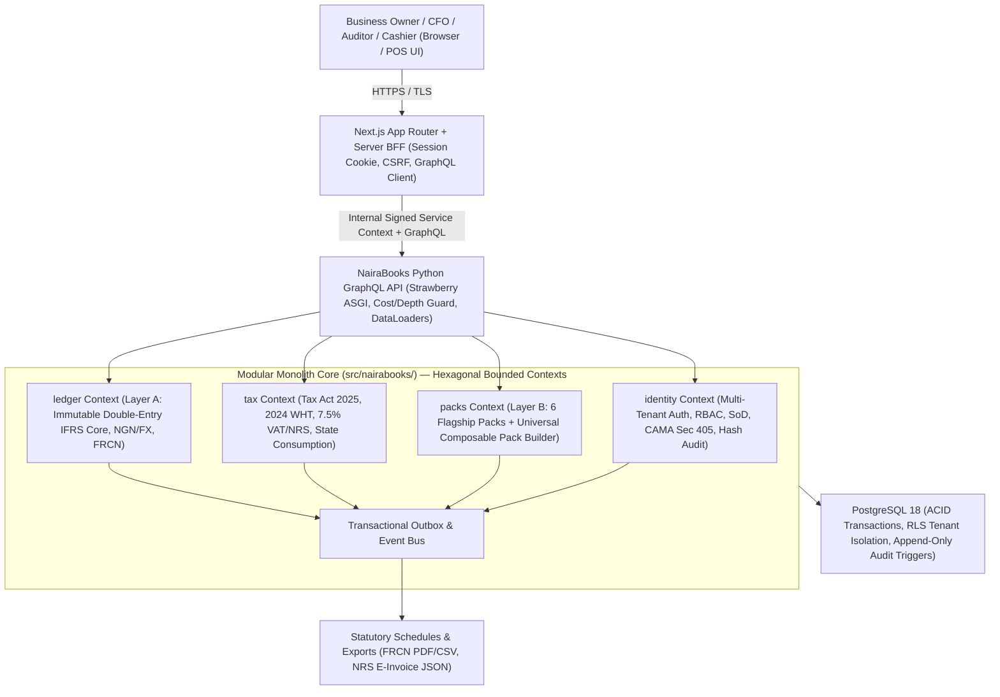

# Phase 3: Core System Architecture & Review (`NairaBooks`)

> Covers `phase-3-architecture` Block 1 (`N3_A`): `architect-review`, `architecture-patterns`, `backend-architect`, `microservices-patterns`, `architecture-decision-records`.

## 1. Plain-English Overview
In Phase 3, we lock **how all parts of `NairaBooks` connect cleanly and safely** before designing PostgreSQL tables (`Phase 4`) or visual screens (`Phase 5`):
- Instead of building brittle separate apps for different industries or splitting accounting across risky distributed databases, `NairaBooks` uses a **Modular Monolith** with **five strictly separated internal modules** matching our 5 Conductor tracks.
- Every Naira and kobo flows through one trusted Python accounting & tax core, exposed via one strongly typed **GraphQL API** (`api/graphql/schema.graphql`), consumed by a fast **Next.js App Router** frontend.

---

## 2. C4 System Context & Container Architecture (`architect-review` & `backend-architect`)



---

## 3. Bounded Contexts & Hexagonal Dependency Rule (`architecture-patterns`)

### Why Modular Monolith Over Early Microservices (`microservices-patterns`)
Per `microservices-patterns` guidelines (*avoid distributed complexity when ACID transactions belong together*), splitting the General Ledger, WHT/VAT computation, inventory COGS posting, and CAMA period locks across independent networked microservices in v1 would force complex distributed Sagas where an immediate ACID rollback is strictly safer for double-entry correctness (`ADR-006`).

Instead, **five logical Bounded Contexts** (aligned 1:1 with `conductor/tracks.md`) obey strict Hexagonal (Ports & Adapters) dependency flow:

```text
src/nairabooks/
├── ledger/              # Track: nigerian-ifrs-core-ledger_20261112
│   ├── domain/          # Money, Account, JournalVoucher, FiscalPeriod, FRCN calculators (ZERO external I/O)
│   ├── application/     # PostVoucherUseCase, ReverseVoucherUseCase, ClosePeriodUseCase, UnitOfWork Port
│   └── adapters/        # SQLAlchemy/Postgres repositories, CSV/FRCN schedule formatters
├── tax/                 # Track: nigerian-tax-rule-engine_20261112
│   ├── domain/          # Effective-dated Nigeria Tax Act 2025, WHT 2024, VAT 7.5%/NRS, State levy rules
│   ├── application/     # PreviewNigerianTaxUseCase, ComputeWhtAndVatUseCase
│   └── adapters/        # Tax rule table repository, NRS e-invoice JSON serializer
├── packs/               # Track: composable-pack-engine_20261112 + flagship-industry-packs_20261112
│   ├── domain/          # OperationalPrimitive catalog, PackDefinition, Hybrid composer invariants
│   ├── application/     # ConfigureIndustryPackUseCase (provisions CoA, tax defaults, KPI widgets)
│   ├── flagship/        # 6 Flagship Reference Packs + Universal Custom Pack templates
│   └── adapters/        # Pack config JSON persistence & operational->ledger posting bridges
├── identity/            # Track: auth-rbac-audit-trail_20261112
│   ├── domain/          # ActorRole, PermissionMatrix, SegregationOfDutiesPolicy, AuditChainHasher
│   ├── application/     # AuthenticateActorUseCase, CertifyCamaSec405UseCase, AppendAuditEventUseCase
│   └── adapters/        # Argon2id password verifier, tenant context middleware, audit repo
└── api/                 # GraphQL BFF Gateway
    ├── graphql/         # Resolvers, Relay connections, DataLoaders, @requireRole & @cost directives
    └── outbox/          # Transactional outbox dispatcher (future microservice extraction seam)
```

### Non-Negotiable Architecture Rules
1. **Inward Dependencies Only:** `domain/` modules may import only Python stdlib (`decimal`, `datetime`, `uuid`, `dataclasses`, `enum`, `typing`, `hashlib`) and pure value-validation primitives. Zero SQL, HTTP, GraphQL, or Next.js imports inside `domain/`.
2. **Double-Entry Write Funnel:** Layer B packs (`POS`, `Warehouse/PO`, `BOM/WIP`, `Job Costing`, `Time/Billing`, `Non-Profit Fund`) **never** write directly to ledger balance columns. Every financial mutation flows through `ledger.application.PostJournalVoucherUseCase`, guaranteeing balanced `Debits == Credits`, period-lock enforcement, idempotency, and append-only audit capture in a single database transaction.
3. **No Cross-Context Table Joins on Writes:** `packs` and `tax` interact with `ledger` strictly through defined Application Service Ports or persisted Outbox domain events. If NRS e-invoice transmission or heavy BI analytics needs independent scaling later, only the Outbox consumer moves out-of-process.
4. **Canonical Python Accounting Brain + Next.js BFF (`ADR-007`):** Financial calculations, tax rules, and GraphQL execution live in one canonical Python engine (`nairabooks`), while the Next.js App Router layer handles SSR UI, secure HTTP-only cookies, CSRF checks, and typed GraphQL operations generated from `api/graphql/schema.graphql`.

---

## 4. Architectural Review & Quality Attribute Assessment (`architect-review`)

| Quality Attribute | Design Mechanism | Risk & Mitigation |
| :--- | :--- | :--- |
| **Correctness (Financial)** | Fixed-precision `Decimal` (`DecimalMoney`/`DecimalRate`), balanced double-entry assertion, idempotency UUIDs | Risk: Client passes JS `number` float -> Mitigation: GraphQL scalar rejects JSON floats (`isinstance(v, float)` rejected at parse boundary) |
| **Multi-Tenant Safety** | Session-bound `workspace_id`, Postgres RLS (Phase 4), resolver tenant assertions | Risk: Insecure direct object IDs across workspaces -> Mitigation: Mandatory `workspace_id` predicate in every repository port |
| **Extensibility (Industries)** | Declarative `OperationalPrimitive` slots composing CoA, tax defaults, labels, and posting adapters | Risk: Hardcoded `if hotel:` branches -> Mitigation: Hybrid Pack Composer operates purely on declarative manifests |
| **Performance (N+1 & Reports)** | Per-request GraphQL DataLoaders for `JournalVoucher -> JournalLines -> ChartOfAccount`, pre-aggregated trial-balance snapshots for closed periods | Risk: Slow 5-Year FRCN summary -> Mitigation: Closed period summary snapshots + keyset cursor pagination |
| **Observability & Auditability** | Correlation IDs per GraphQL request, append-only hash-chained `AuditEvent`, `CamaSec405Certification` snapshot hashes | Risk: Silent mutation or log tampering -> Mitigation: DB `REVOKE UPDATE/DELETE` + hash chain verification |
