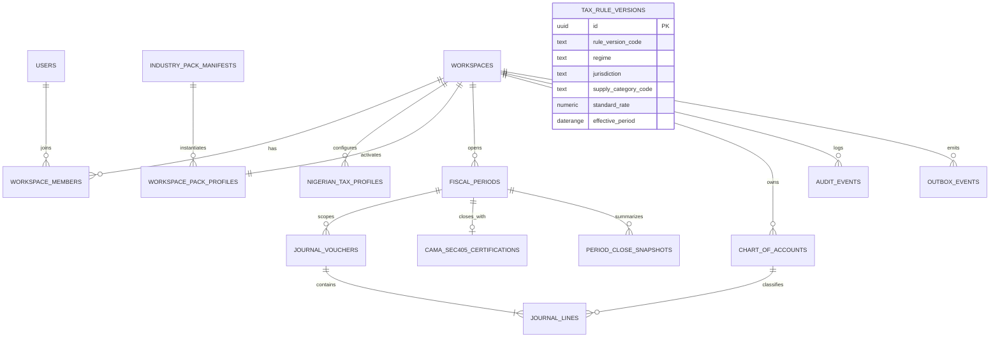

# Phase 4: Database & Data Persistence Architecture (`NairaBooks`)

> Covers all 9 skills in `phase-4-database`: `database-architect`, `postgresql`, `sql-pro`, `sql-optimization-patterns`, `database-optimizer`, `database-admin`, `database-migrations-sql-migrations`, `database-migration`, `database-migrations-migration-observability`.

## 1. Plain-English Overview
**`NairaBooks`** saves every Naira and kobo inside **PostgreSQL 18.3** with strict financial safety checks built right into the database itself:
- Every company workspace gets its own strict privacy fence (**Row-Level Security**) so one company can never read or alter another company's accounts.
- Every posted ledger voucher is checked by PostgreSQL to verify **Debits equal Credits** and cannot be silently edited or deleted after posting (and the audit log cannot be edited or deleted at all).
- Nigerian tax rules live in **effective-dated tables** that prevent overlapping dates for the same tax category, while the **6 Flagship Reference Packs** and **Universal Custom Pack Builder** store composable manifests in validated `JSONB`.

---

## 2. Entity-Relationship Diagram (`database-architect`)

---

## 3. PostgreSQL 18 Design Standards (`postgresql`)
Implemented in [`db/migrations/0001_initial_core_schema.sql`](../db/migrations/0001_initial_core_schema.sql) and [`db/migrations/0002_rls_and_ledger_invariants.sql`](../db/migrations/0002_rls_and_ledger_invariants.sql):

1. **Zero Floating-Point & Legacy Types:**
   - Money columns use `NUMERIC(20, 2)` (`total_debit_ngn`, `debit_ngn`, `credit_ngn`, `annual_turnover_ngn`); tax & FX rates use `NUMERIC(10, 6)`.
   - Zero `FLOAT`, `REAL`, `DOUBLE PRECISION`, `MONEY`, `SERIAL`, `VARCHAR(n)`, `CHAR(n)`, or timezone-naive `TIMESTAMP` types.
   - All domain primary keys use PostgreSQL 18 `uuidv7()` (time-ordered UUIDs preserving B-tree append locality!). High-volume ordered tables (`audit_events.sequence_number`, `outbox_events.sequence_id`, `schema_migration_runs.id`) use `BIGINT GENERATED ALWAYS AS IDENTITY`.
   - Text fields use `TEXT` with explicit `CHECK (length(col) <= n)` constraints; timestamps use `TIMESTAMPTZ`.
2. **Database-Enforced Accounting & Tax Invariants:**
   - **`excl_tax_rule_no_overlap` (`btree_gist`):** `EXCLUDE USING gist` prevents overlapping `DATERANGE` rows for the same `(regime, jurisdiction, supply_category_code)`.
   - **`excl_workspace_period_overlap`:** Prevents overlapping fiscal periods within the same workspace.
   - **`trg_verify_posted_voucher_balance` (`DEFERRABLE INITIALLY DEFERRED`):** Confirms every `POSTED` voucher targets an `OPEN` period, contains `>= 2` lines, and has matching `SUM(debit_ngn) = SUM(credit_ngn) = total_debit_ngn`.
   - **`trg_immutable_audit_events` & `trg_immutable_posted_vouchers` / `lines`:** Blocks `UPDATE`/`DELETE` on audit records (`SEC-REQ-05`) and prevents retroactive amount/date tampering (`SEC-REQ-03`).
   - **Row-Level Security (`SEC-REQ-08`):** Enabled on all 11 tenant-scoped tables via `current_workspace_uuid()`.

---

## 4. Query Optimization, Indexing & Partitioning (`sql-pro`, `sql-optimization-patterns`, `database-optimizer`)

Canonical SQL queries live in [`db/queries/frcn_and_tax_analytics.sql`](../db/queries/frcn_and_tax_analytics.sql) and indexes in [`db/migrations/0003_indexes_and_observability.sql`](../db/migrations/0003_indexes_and_observability.sql):

- **Manual Indexes on All Foreign Keys:** Every FK referencing column has an explicit B-tree index to prevent sequential child scans on parent updates/deletes and accelerate joins.
- **Keyset Cursor Pagination + Covering Indexes:** `idx_vouchers_workspace_keyset` (`(workspace_id, posting_date DESC, id DESC) INCLUDE (voucher_number, status, total_debit_ngn, reference)`) powers GraphQL Relay pagination with `Index Only Scan` and O(1) seek cost (no slow `OFFSET`).
- **Pre-Aggregated Closed Period Snapshots:** `period_close_snapshots` stores verified balances at period close so multi-year FRCN Five-Year Financial Summary queries read summarized rows rather than scanning multi-year `journal_lines`.
- **Window Functions & Partial/GIN Indexes:**
  - Running account balances use `SUM(debit_ngn - credit_ngn) OVER (PARTITION BY account_id ORDER BY ...)`.
  - Outbox polling uses partial index `idx_outbox_pending WHERE processed_at IS NULL` paired with `FOR UPDATE SKIP LOCKED`.
  - Industry pack queries use `GIN (active_primitives)` and `GIN (config jsonb_path_ops)`.
- **Scale Thresholds (Partitioning & `EXPLAIN` Verification Gate):**
  - Validate high-volume queries in Phase 6/8 staging with `EXPLAIN (ANALYZE, BUFFERS)` and `pg_stat_statements`.
  - Partition `journal_lines` and `audit_events` declaratively (`PARTITION BY RANGE (created_at)`) when projected table growth approaches `100M+` rows.

---

## 5. Database Operations & Connection Pooling Runbook (`database-admin`)

| Operational Concern | NairaBooks Standard | Why / Tradeoff |
| :--- | :--- | :--- |
| **Connection Pooling** | **PgBouncer (`pool_mode = transaction`)** | Prevents connection exhaustion across ASGI workers. **Critical Rule:** Tenant context MUST be bound inside transaction via `SET LOCAL app.current_workspace_id = '<uuid>'` (never session `SET`) so pooled connections cannot bleed tenant state. |
| **Backup & PITR** | Continuous WAL archiving + nightly encrypted base backups | Targets **RPO `<= 5 minutes`**, **RTO `<= 30 minutes`**; monthly automated restore drills verify backup usability. |
| **Autovacuum & Bloat** | Aggressive vacuum on `outbox_events` (`fillfactor = 90` when churn scales); append-only `journal_lines`/`audit_events` generate minimal dead tuples | Keeps index bloat minimal under POS & Outbox worker load. |
| **Privilege Least-Access** | Application role runs migrations/DDL strictly in deploy step (`app_migrator`), while runtime app role (`app_runtime`) lacks DDL and lacks `UPDATE`/`DELETE` on `audit_events` | Defense-in-depth enforcement even against application-layer SQL injection attempts. |

---

## 6. Zero-Downtime Migrations, Rollbacks & CDC Observability (`N4_B`)
Implemented in [`src/nairabooks/adapters/migrations.py`](../src/nairabooks/adapters/migrations.py) and [`db/migrations/`](../db/migrations/):

1. **Expand -> Backfill -> Contract Lifecycle:**
   - **Expand:** Add nullable columns or new tables + `CREATE INDEX CONCURRENTLY` (outside multi-statement transaction locks) with `lock_timeout = 3000ms` and `statement_timeout = 30000ms`.
   - **Backfill:** Batched updates with throttle sleeps (`10,000` rows/batch) while old/new application code dual-reads safely.
   - **Contract:** Only drop legacy columns in a dedicated later migration after old app versions drain (`audit_forward_migration_safety` enforces this check).
2. **Paired Rollbacks & Drift Detection:** Every `NNNN_*.sql` forward script has a paired `rollbacks/NNNN_rollback.sql` verified for deterministic SHA-256 checksums (`MigrationObserver.detect_checksum_drift`).
3. **Observability & Debezium CDC Readiness:**
   - `schema_migration_runs` & `v_migration_observability` capture `strategy`, `duration_ms`, `rows_affected`, and `error_detail`.
   - `MigrationRunRecord.to_json_log()` outputs structured JSON metrics, and `debezium_cdc_slot_config()` defines the `pgoutput` logical replication configuration (`decimal.handling.mode = "string"`) to stream `outbox_events`, `audit_events`, and `journal_vouchers` into downstream reporting/NRS pipelines cleanly without dual-write risks.
