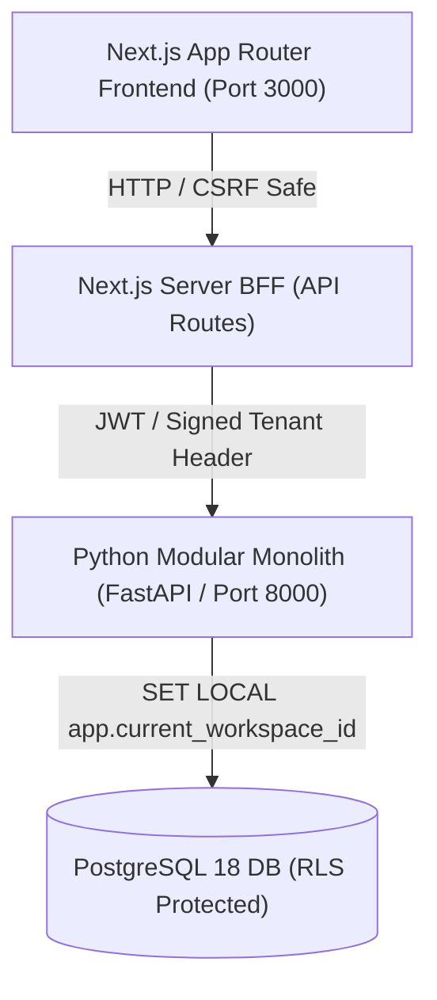
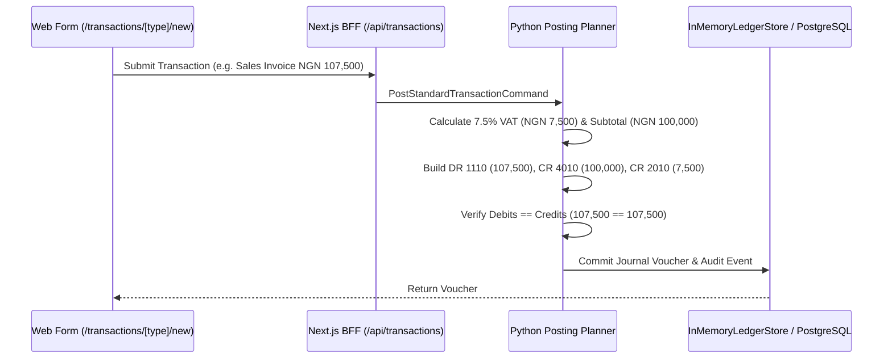

# NairaBooks Technical & Architectural Manual (`docs/TECHNICAL_MANUAL.md`)

> **Comprehensive Technical Architecture, Domain Modeling, and Invariant Reference**  
> *Author: NairaBooks Core Architecture Team*  
> *Standard: Hexagonal Architecture, Zero Float Invariant, Nigerian Statutory Compliance*

---

## 1. Executive Summary & System Overview

**NairaBooks** is a high-integrity, multi-tenant accounting and enterprise resource management platform engineered specifically for the Nigerian business and statutory regulatory landscape.

Traditional accounting platforms (such as QuickBooks, Sage, or Xero) were designed around Western accounting concepts and often fail to handle Nigerian statutory mandates cleanly:
1. **Withholding Tax (WHT) Deductions at Source:** In Nigeria, clients deduct 2%, 5%, or 10% WHT before paying invoices. NairaBooks models WHT Credit Notes Receivable (`GL 1150`) as an asset deducted at the point of receipt, rather than an afterthought.
2. **Value Added Tax (VAT 7.5%):** Automated isolation of Output VAT (`GL 2010`) and Input VAT (`GL 1140`) with exact kobo precision.
3. **Nigeria Tax Act 2025 CIT Radar:** Real-time small company turnover classification (`₦100M` and `₦250M` thresholds) with automatic disqualification of professional services (legal, medical, engineering, auditing).
4. **CAMA 2020 Statutory Compliance:** Double-entry journal balance enforcement (Section 377), immutable 6-year retention (Section 374), and Segregation of Duties for financial statements certification (Section 405).

---

## 2. Core Architectural Principles



### 2.1 The Hexagonal Modular Monolith
The backend (`src/nairabooks/`) is organized into five strict hexagonal bounded contexts:
- **`ledger/`**: Double-entry journal vouchers, Chart of Accounts, fiscal periods, and financial reports.
- **`tax/`**: Effective-dated Nigerian tax rules (VAT, WHT, CIT exemption radar).
- **`packs/`**: Composable industry profile engine (Retail, Wholesale, Manufacturing, Construction, Services, Non-Profit).
- **`identity/`**: Multi-tenant workspace isolation, RBAC permissions, and CAMA Sec 405 Segregation of Duties.
- **`compliance/`**: NDPA 2023 DSAR exports, PII anonymization, and 6-year CAMA 2020 retention locks.

### 2.2 The Zero-Binary-Float Invariant
Binary floating-point arithmetic (`0.1 + 0.2 = 0.30000000000000004`) causes fatal kobo rounding discrepancies in accounting ledgers.
- **Python Backend:** Every financial calculation uses `decimal.Decimal` with explicit quantization:
  ```python
  MONEY_QUANTUM = Decimal("0.01")
  amount.quantize(MONEY_QUANTUM, rounding=ROUND_HALF_UP)
  ```
- **TypeScript Frontend:** Amounts are transmitted as formatted decimal strings (`"150000.00"`) or integer kobo in `BigInt` (`15000000n`).
- **PostgreSQL Database:** Stored strictly as `NUMERIC(20, 2)` for currency and `NUMERIC(10, 6)` for tax percentages.

---

## 3. Database Invariants & Multi-Tenancy (PostgreSQL 18)

### 3.1 Row-Level Security (RLS)
Every tenant-scoped table enforces PostgreSQL Row-Level Security:
```sql
ALTER TABLE journal_vouchers ENABLE ROW LEVEL SECURITY;
CREATE POLICY tenant_isolation_policy ON journal_vouchers
  FOR ALL
  USING (workspace_id = current_workspace_uuid());
```
Connection pools (e.g. PgBouncer in transaction mode) execute `SET LOCAL app.current_workspace_id = '...'` at the start of each transaction, guaranteeing that even if application logic forgets a tenant filter, the database rejects cross-tenant data access.

### 3.2 Immutability Triggers
Vouchers in `POSTED` or `REVERSED` status cannot be modified or deleted:
```sql
CREATE TRIGGER trg_voucher_immutability
  BEFORE UPDATE OR DELETE ON journal_vouchers
  FOR EACH ROW
  EXECUTE FUNCTION fn_prevent_posted_voucher_mutation();
```
To correct an error, users must post an explicit reversing journal voucher (`is_reversal = true`), maintaining a pristine audit trail.

---

## 4. Operational Transaction Posting Pipeline



1. **Input Normalization:** Operational inputs (customer ID, items, tax treatment) are validated.
2. **Posting Plan Generation:** `StandardTransactionPostingPlanner` maps the event to statutory General Ledger accounts.
3. **Decimal Quantization:** Every line is quantized to `0.01` kobo.
4. **Debit/Credit Equality Check:** Invariant `sum(debits) == sum(credits)` is asserted.
5. **Period Lock Check:** Posting date is checked against open fiscal periods.
6. **Atomic Commit:** Voucher, lines, and hash-chained audit events are committed in a single transaction.

---

## 5. Security & DevSecOps Controls
- **Static Analysis (SAST):** Custom AST scanner ([`scripts/run_sast_scan.py`](file:///c:/Users/Czernoxx/Documents/emmanuel/ac/scripts/run_sast_scan.py)) checking for SQL injections, XSS vulnerabilities, and secrets.
- **HTTP Security Headers:** Strict Content Security Policy (CSP), HSTS (2 years), X-Frame-Options: DENY, and nosniff.
- **Regulatory Audits:** Continuous programmatic checks ([`scripts/compliance_check.py`](file:///c:/Users/Czernoxx/Documents/emmanuel/ac/scripts/compliance_check.py)) against NDPA 2023, CAMA 2020, and the Nigeria Tax Act 2025.
- **Dependency Auditing:** Automated license scanning ([`scripts/audit_dependencies.py`](file:///c:/Users/Czernoxx/Documents/emmanuel/ac/scripts/audit_dependencies.py)) ensuring 100% permissive licenses with zero copyleft risk.
