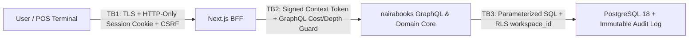

# Security Threat Model (`docs/THREAT_MODEL.md`)

> Covers `phase-3-architecture` Block 3 (`N3_E`): `threat-modeling-expert`, `stride-analysis-patterns`, `attack-tree-construction`, `security-requirement-extraction`, `threat-mitigation-mapping`.

## 1. System Scope, Trust Boundaries & Data Flow Diagram

### Trust Boundaries
- **TB1 (External Edge):** Browser / POS Terminal -> HTTPS/TLS -> Next.js App Router BFF
- **TB2 (Service Boundary):** Next.js BFF -> Authenticated Internal Context -> Python `nairabooks` GraphQL Engine
- **TB3 (Data Boundary):** `nairabooks` Repositories -> Parameterized Queries + PostgreSQL RLS (`workspace_id`) -> PostgreSQL 18 Storage



### Critical Assets
| Asset ID | Asset | Sensitivity | Confidentiality / Integrity Priority |
| :--- | :--- | :--- | :--- |
| `AST-01` | Tenant General Ledger & FRCN Financial Statements | Critical | Maximum Integrity & Confidentiality |
| `AST-02` | Effective-Dated Nigerian Tax Rules & Workspace Tax Profiles (TIN, Turnover) | High | Maximum Integrity (tampering distorts tax compliance) |
| `AST-03` | User Credentials, Session Secrets, & Signed Context Keys | Critical | Maximum Confidentiality |
| `AST-04` | Append-Only Audit Log & CAMA Sec 405 Sign-Off Hashes | Critical | Maximum Integrity & Non-Repudiation |
| `AST-05` | Declarative Industry Pack & Hybrid Composition Manifests | Medium | Integrity (unauthorized CoA/mapping changes) |

---

## 2. STRIDE Threat Analysis Matrix (`stride-analysis-patterns`)

| ID | Category | Threat Scenario | Target Asset | Likelihood | Impact |
| :--- | :--- | :--- | :--- | :--- | :--- |
| `S1` | **Spoofing** | Attacker hijacks or forges a session cookie or context token to impersonate a CFO/Owner | `AST-03` | Medium | Critical |
| `S2` | **Spoofing** | Spoofed client header (`X-Workspace-Id`) tricks backend into switching tenant context | `AST-01` | High | Critical |
| `T1` | **Tampering** | IEEE-754 float precision drift or client-supplied fractional rounding alters VAT/WHT or ledger totals | `AST-01`, `AST-02` | High | Critical |
| `T2` | **Tampering** | Actor alters or deletes a previously `POSTED` journal voucher, audit log entry, or closed CAMA Sec 405 period | `AST-01`, `AST-04` | Medium | Critical |
| `T3` | **Tampering** | Tenant overrides statutory Nigeria Tax Act 2025 rate/exemption thresholds in UI payload | `AST-02` | Medium | High |
| `R1` | **Repudiation** | Director or accountant disputes certifying CAMA Sec 405 statements or posting/reversing high-value vouchers | `AST-04` | Medium | High |
| `R2` | **Repudiation** | POS cashier voids sales or manipulates daily cash-up without traceable device/user attribution | `AST-01`, `AST-04` | High | High |
| `I1` | **Info Disclosure** | Cross-tenant IDOR/BOLA via UUID guessing in `journalVouchers` or `frcnFinancialPackage` leaks competitor financials/TINs | `AST-01`, `AST-02` | High | Critical |
| `I2` | **Info Disclosure** | Production GraphQL introspection or unhandled traceback reveals internal DB schema, TINs, or secrets | `AST-01`, `AST-03` | Medium | High |
| `D1` | **Denial of Service** | Deeply nested GraphQL queries (`workspace -> vouchers -> lines`) or huge `first: 999999` exhaust CPU/DB | `AST-01` | High | High |
| `D2` | **Denial of Service** | Unthrottled 5-Year FRCN aggregation requests or duplicate POS retry storms saturate Postgres connections | `AST-01` | Medium | Medium |
| `E1` | **Elevation of Privilege** | Bookkeeper or Cashier creates and self-approves an unverified manual adjustment or closes fiscal period | `AST-01`, `AST-04` | Medium | Critical |
| `E2` | **Elevation of Privilege** | `EXTERNAL_AUDITOR_READONLY` attempts mutation operations (`postJournalVoucher`, `configureIndustryPack`) | `AST-01`, `AST-05` | Medium | High |

---

## 3. AND/OR Attack Trees (`attack-tree-construction`)

### Attack Tree 1: Fraudulent Ledger Alteration & Evidence Concealment
```text
[Root Goal: Alter Posted Nigerian Financial Statements Without Detection]
 ├── [OR] Bypass Application Layer Immutability
 │    ├── [AND] Steal DB credentials (Cost: High, Skill: High, Detection: Medium)
 │    │    └── [OR] Execute SQL UPDATE/DELETE on journal_lines & audit_events
 │    │         (Blocked by Postgres REVOKE UPDATE/DELETE + triggers + off-table hash chain verification)
 │    └── [AND] Re-open CLOSED_CAMA_CERTIFIED fiscal period (Skill: Medium, Detection: High)
 │         └── Requires OWNER/CFO token + triggers high-severity immutable audit alert
 ├── [OR] Inject Imbalanced / Unapproved Journal Voucher (Segregation of Duties Bypass)
 │    ├── [AND] Submit custom GraphQL payload omitting line balancing (Cost: Low, Detection: Certain)
 │    │    (Blocked by domain UnbalancedJournalError + DB constraint checks)
 │    └── [AND] Create voucher as Bookkeeper + self-approve using stolen CFO token (Skill: Medium, Detection: Medium)
 │         (Blocked by created_by != approved_by SoD invariant + MFA/step-up auth)
 └── [OR] Exploit Tax Rule Manipulation
      └── [AND] Tamper statutory Nigeria Tax Act 2025 / WHT table OR pass negative VAT rate in API
           (Blocked: tax rule tables are read-only reference data; API accepts supplyCategoryCode only, never raw rates)
```

### Attack Tree 2: Cross-Tenant Financial Data Exfiltration
```text
[Root Goal: Read Another Business's Ledger, TIN, or Revenue via GraphQL]
 ├── [OR] Spoof Workspace Context Header (Cost: Low, Skill: Low)
 │    └── [Leaf] Send X-Workspace-Id=<victim-uuid> from client browser
 │         (Mitigated: workspaceId extracted ONLY from cryptographically signed server session)
 ├── [OR] Broken Object Level Authorization (IDOR) on Node UUIDs (Cost: Low, Skill: Medium)
 │    └── [Leaf] Request frcnFinancialPackage(fiscalPeriodId: <victim-uuid>)
 │         (Mitigated: mandatory workspace_id predicate in Domain UseCase + Postgres RLS policy)
 └── [OR] Inference via Verbose GraphQL Error / Stack Trace (Cost: Low, Skill: Low)
      └── [Leaf] Probe UUIDs to distinguish "exists in other tenant" vs "not found"
           (Mitigated: uniform CrossTenantAccessError / generic authorization error without leaking existence)
```

---

## 4. Extracted Security Requirements (`security-requirement-extraction`)

| Req ID | Type | Category | Verifiable Requirement | Linked Threats | Compliance Map |
| :--- | :--- | :--- | :--- | :--- | :--- |
| `SEC-REQ-01` | Functional | Auth / Session | Next.js BFF MUST bind every authenticated request to `HTTP-only`, `Secure`, `SameSite=Lax` cookies; `workspaceId` MUST NEVER be read from untrusted client headers or GraphQL input args. | `S1`, `S2`, `I1` | OWASP ASVS V3 |
| `SEC-REQ-02` | Constraint | Financial Math | API and Domain layers MUST reject IEEE-754 `float` types on monetary/tax fields (`DecimalMoney`/`DecimalRate` strings -> `Decimal` only). | `T1` | IFRS / Integrity |
| `SEC-REQ-03` | Functional | Data Integrity | Posted vouchers and closed fiscal periods MUST be immutable (`UPDATE`/`DELETE` denied); corrections require linked reversal vouchers. | `T2`, `R1` | CAMA 2020 Sec 405 |
| `SEC-REQ-04` | Constraint | Tax Rules | GraphQL mutations/queries MUST NOT accept caller-supplied statutory tax percentages; server resolves effective-dated Nigeria Tax Act / WHT / VAT rules by `transactionDate` & `supplyCategoryCode`. | `T3` | Nigeria Tax Act 2025 |
| `SEC-REQ-05` | Functional | Non-Repudiation | Every ledger/tax/pack/CAMA state change MUST append a hash-chained `AuditEvent` (`payloadHash` + `previousEventHash`) with Postgres `UPDATE`/`DELETE` privileges revoked. | `T2`, `R1`, `R2` | NDPA / CAMA 2020 |
| `SEC-REQ-06` | Functional | Authorization | Dual-control / Segregation of Duties (`createdByUserId != approvedByUserId`) MUST be enforced for CAMA Sec 405 certifications and configured journal approvals. | `E1` | OWASP ASVS V4 |
| `SEC-REQ-07` | Functional | Authorization | `@requireRole` MUST be verified at GraphQL field middleware AND domain use-case boundary (zero trust of upstream UI hiding). | `E1`, `E2` | OWASP ASVS V4 |
| `SEC-REQ-08` | Functional | Tenant Isolation | Every SQL query and Postgres table holding tenant data MUST filter by `workspace_id` and enforce Row-Level Security (RLS) defense-in-depth in Phase 4. | `S2`, `I1` | NDPA 2023 / OWASP API1 |
| `SEC-REQ-09` | Non-Functional | Availability | GraphQL engine MUST enforce query depth cap (`<= 8`), `@cost` complexity limit (`<= 500`), pagination limit (`first <= 100`), and rate limits per IP/actor. | `D1`, `D2` | OWASP API4 |
| `SEC-REQ-10` | Functional | Idempotency | All posting/reversal mutations MUST require UUID `idempotencyKey` deduplicated atomically within DB transaction scope. | `D2`, `T1` | Financial Reliability |
| `SEC-REQ-11` | Constraint | Confidentiality | Production deployments MUST disable GraphQL introspection/Playground and sanitize stack traces/TINs/passwords from error responses & structured logs. | `I2` | NDPA 2023 / OWASP V7 |
| `SEC-REQ-12` | Constraint | Crypto / Passwords | User passwords MUST use `Argon2id` (memory-hard KDF), and secret keys MUST originate strictly from environment/secret-manager injection, never committed code. | `S1`, `AST-03` | OWASP ASVS V2/V6 |

---

## 5. Defense-in-Depth Threat Mitigation Mapping (`threat-mitigation-mapping`)

| Threat(s) | Control Type | Defense Layer | Concrete Control | Target Phase / Verification |
| :--- | :--- | :--- | :--- | :--- |
| `S1`, `S2` | Preventive | Network & BFF | TLS 1.3 + HTTP-only `SameSite` session cookies + signed internal BFF-to-GraphQL user/workspace assertion | Phase 7 & 9 Auth/Security tests |
| `T1` | Preventive | API & Domain | `DecimalMoney` scalar validator + `Decimal` arithmetic (`ROUND_HALF_EVEN` / statutory precision) + balanced voucher invariant | Phase 2 (`test_scaffold`), Phase 3 (`test_architecture_contracts`), Phase 6 TDD |
| `T2`, `R1`, `R2` | Preventive + Detective | Domain & Postgres | Append-only voucher design + hash-chained `AuditEvent` + Postgres `REVOKE UPDATE/DELETE` + periodic chain verifier | Phase 4 Postgres schema + Phase 6/8 audit chain tests |
| `T3` | Preventive | Domain (`tax`) | Server-side immutable effective-dated statutory rule registry (`NG-WHT-2024`, `NG-NTA-2025`, `NG-VAT-75`) | Phase 6 Tax Engine TDD tests |
| `I1` | Preventive | Application & Data | Tenant-scoped `ExecutionContext` + repository `workspace_id` filters + Postgres RLS policies | Phase 4 RLS tests + Phase 7/8 IDOR negative tests |
| `I2` | Preventive | Application | Production `introspection=False`, generic `CrossTenantAccessError`, PII log redaction filter (`TIN`, passwords, tokens) | Phase 6 error middleware + Phase 9 SAST/security scan |
| `D1`, `D2` | Preventive | Application & DB | Query depth (`<= 8`) + `@cost` (`<= 500`) + `first <= 100` caps + `idempotencyKey` unique index + PgBouncer pool bounds | Phase 4 DB indexes + Phase 8 API/load safety tests |
| `E1`, `E2` | Preventive + Detective | Application | `@requireRole` guards + Domain RBAC matrix + SoD `actor != creator` check + audit alert logs | Phase 7 RBAC + Phase 8 authorization bypass tests |
