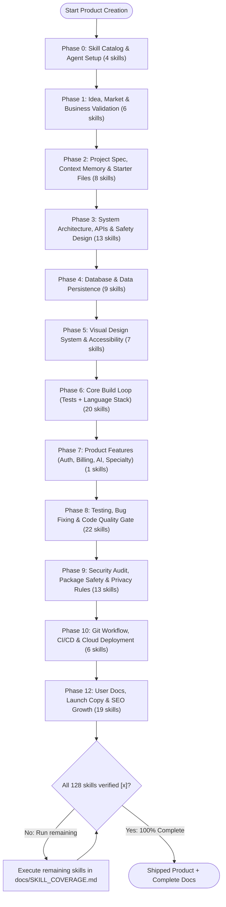

# Dynamic Workflow Plan — `ac`

Generated dynamically from your Skills Decision Wizard choices (**128 / 128 selected skills mapped** across **12 active phases**).

---

## 1. Your Wizard Choices Summary

| Question | Your Decision |
| :--- | :--- |
| `Q0` (Step 1: Tool Setup) | **Yes — also tune AI agent prompts** |
| `Q1` (Step 2: Idea Check) | **Check competitors & market demand first** |
| `Q2` (Step 3: Project Plan & Memory) | **Brand new project today** |
| `Q2_SCAF` (Step 4: Starter Files) | **Yes — Python starter (uv)** |
| `Q3` (Step 5: App Size & Structure) | **Standard web or mobile app** |
| `Q3_API` (Step 6: Server APIs & Input Safety) | **Yes — GraphQL API + safety checks** |
| `Q4` (Step 7: Saving Data) | **Yes — database + safe live updates (Recommended)** |
| `Q5` (Step 8: Screens & Design) | **Yes — screens + accessibility check (Recommended)** |
| `Q6` (Step 9: Coding Style & Tests) | **Write tests first, then code (TDD — Safest)** |
| `Q6_STACK` (Step 10: Language / Platform) | **Website / Web App (Next.js / React / TS)** |
| `Q7_AUTH` (Step 11: Accounts & Payments) | **Login / user accounts only (free app)** |
| `Q7_AI` (Step 12: AI Features Inside App) | **No AI features inside the app** |
| `Q7_EXTRA` (Step 13: Specialty Domains) | **None of these — regular web/mobile/API app** |
| `Q8` (Step 14: Testing & Code Review) | **Click through UI in a real browser + review** |
| `Q9` (Step 15: Security & Privacy Rules) | **Public launch with real user data** |
| `Q10` (Step 16: Git & Putting It Online) | **Keep local / GitHub PRs only (no cloud host)** |
| `Q11` (Step 17: Live Crash Alerts) | **Skip for now (MVP / basic host logs)** |
| `Q12` (Step 18: Docs & Marketing) | **Everything (Docs + Launch Copy + Support + SEO)** |

---

## 2. How This Workflow Runs (Dynamic Orchestration)
- **Spec & Track Engine:** **Conductor Active** (`conductor/product.md`, `conductor/tracks.md` slice loop)
- **Coding Discipline:** **Strict TDD Red -> Green -> Refactor** per task
- **Every Stage / Slice Always Ends With:** `stage-doc-sync` (updates `docs/`) + `kit-context-checkpoint` (saves `docs/STATE.md` & `docs/SESSION_HANDOFF.md`) + `docs/SKILL_COVERAGE.md` check-offs.

---

## 3. Phase-by-Phase Execution Plan (100% of Selected Skills)

### Phase 0: Skill Catalog & Agent Setup
- **Plain-English Goal:** Prepare your toolset and agent prompts before starting.
- **Cadence:** `Run Once (Foundation)`
- **Required Docs Updated on Closeout:** `docs/STAGE_LOG.md`, `docs/SKILL_COVERAGE.md` + `docs/SKILL_COVERAGE.md`

- **Catalog & DX Init:** `antigravity-skills-manager`, `dx-optimizer`
- **Agent Tuning:** `agent-orchestration-improve-agent`, `agent-orchestration-multi-agent-optimize`

### Phase 1: Idea, Market & Business Validation
- **Plain-English Goal:** Check user demand, competitors, and business viability before writing specs.
- **Cadence:** `Run Once (Foundation)`
- **Required Docs Updated on Closeout:** `docs/PRD.md`, `docs/DECISIONS.md`, `docs/STAGE_LOG.md` + `docs/SKILL_COVERAGE.md`

- **Market & Competitor Validation:** `search-specialist`, `competitive-landscape`, `market-sizing-analysis`, `startup-analyst`, `business-analyst`, `startup-metrics-framework`

### Phase 2: Project Spec, Context Memory & Starter Files
- **Plain-English Goal:** Lock what the product does, set up Conductor tracking, and create the starter folder.
- **Cadence:** `Run Once (Foundation)`
- **Required Docs Updated on Closeout:** `docs/PRD.md`, `docs/STATE.md`, `docs/SESSION_HANDOFF.md`, `docs/STAGE_LOG.md` + `docs/SKILL_COVERAGE.md`

- **Conductor Project Init:** `conductor-setup`, `context-driven-development`
- **Spec Gate & Track Creation:** `conductor-validator`, `conductor-new-track`, `track-management`, `conductor-manage`
- **Python Project Scaffold:** `python-development-python-scaffold`, `uv-package-manager`

### Phase 3: System Architecture, APIs & Safety Design
- **Plain-English Goal:** Plan how screens, server endpoints, and safety checks fit together.
- **Cadence:** `Run Once (Foundation)`
- **Required Docs Updated on Closeout:** `docs/ARCHITECTURE.md`, `docs/DECISIONS.md`, `docs/STAGE_LOG.md` + `docs/SKILL_COVERAGE.md`

- **Core Backend Architecture:** `architect-review`, `architecture-patterns`, `backend-architect`, `microservices-patterns`, `architecture-decision-records`
- **GraphQL Contracts:** `api-design-principles`, `graphql-architect`, `api-documenter`
- **Threat Modeling (Security by Design):** `threat-modeling-expert`, `stride-analysis-patterns`, `attack-tree-construction`, `security-requirement-extraction`, `threat-mitigation-mapping`

### Phase 4: Database & Data Persistence
- **Plain-English Goal:** Design how data is saved cleanly and updated without losing user records.
- **Cadence:** `Run Once (Foundation)`
- **Required Docs Updated on Closeout:** `docs/ARCHITECTURE.md`, `docs/DECISIONS.md`, `docs/STAGE_LOG.md` + `docs/SKILL_COVERAGE.md`

- **Relational SQL & Postgres:** `database-architect`, `postgresql`, `sql-pro`, `sql-optimization-patterns`, `database-optimizer`, `database-admin`
- **Zero-Downtime Migrations & CDC:** `database-migrations-sql-migrations`, `database-migration`, `database-migrations-migration-observability`

### Phase 5: Visual Design System & Accessibility
- **Plain-English Goal:** Choose layout, colors, fonts, and keyboard/screen-reader accessibility first.
- **Cadence:** `Run Once (Foundation)`
- **Required Docs Updated on Closeout:** `docs/ARCHITECTURE.md`, `docs/DECISIONS.md`, `docs/USER_GUIDE.md`, `docs/STAGE_LOG.md` + `docs/SKILL_COVERAGE.md`

- **UI/UX & Tailwind Design System:** `ui-ux-designer`, `tailwind-design-system`, `kpi-dashboard-design`, `article-illustrations`
- **WCAG & Screen Reader Audits:** `wcag-audit-patterns`, `accessibility-compliance-accessibility-audit`, `screen-reader-testing`

### Phase 6: Core Build Loop (Tests + Language Stack)
- **Plain-English Goal:** Build your core app features slice-by-slice with test safety nets.
- **Cadence:** `Repeat Per Vertical Feature Slice`
- **Required Docs Updated on Closeout:** `docs/STATE.md`, `docs/STAGE_LOG.md`, `docs/USER_GUIDE.md` + `docs/SKILL_COVERAGE.md`

- **Conductor Outer Loop:** `conductor-implement`, `workflow-patterns`, `full-stack-orchestration-full-stack-feature`, `backend-development-feature-development`
- **Strict TDD Inner Loop:** `tdd-orchestrator`, `tdd-workflows-tdd-cycle`, `tdd-workflows-tdd-red`, `tdd-workflows-tdd-green`, `tdd-workflows-tdd-refactor`
- **Web / Next.js / TypeScript:** `typescript-pro`, `typescript-advanced-types`, `javascript-pro`, `modern-javascript-patterns`, `nextjs-app-router-patterns`, `frontend-developer`, `frontend-mobile-development-component-scaffold`, `react-state-management`, `react-modernization`, `nodejs-backend-patterns`
- **Resilient Error Handling:** `error-handling-patterns`

### Phase 7: Product Features (Auth, Billing, AI, Specialty)
- **Plain-English Goal:** Wire login, payments, AI/OCR, or specialized engines into working slices.
- **Cadence:** `Repeat Per Vertical Feature Slice`
- **Required Docs Updated on Closeout:** `docs/PRD.md`, `docs/ARCHITECTURE.md`, `docs/STAGE_LOG.md`, `docs/USER_GUIDE.md` + `docs/SKILL_COVERAGE.md`

- **Auth & RBAC:** `auth-implementation-patterns`

### Phase 8: Testing, Bug Fixing & Code Quality Gate
- **Plain-English Goal:** Verify features end-to-end, squash failures (if red), and clean code (when green).
- **Cadence:** `Repeat Per Vertical Feature Slice`
- **Required Docs Updated on Closeout:** `docs/STAGE_LOG.md`, `docs/SKILL_COVERAGE.md`, `docs/STATE.md` + `docs/SKILL_COVERAGE.md`

- **JS/TS Testing & API Mocks:** `javascript-testing-patterns`, `unit-testing-test-generate`, `test-automator`, `api-testing-observability-api-mock`
- **E2E & Visual QA:** `e2e-testing-patterns`, `ui-visual-validator`
- **Debug & Track Rollback *(Conditional on failure — also verify with 1 resilience/dry-run check before launch)*:** `debugger`, `debugging-strategies`, `error-detective`, `debugging-toolkit-smart-debug`, `error-debugging-error-analysis`, `distributed-debugging-debug-trace`, `conductor-revert`
- **Code Review, Refactor & Perf:** `code-reviewer`, `code-review-excellence`, `code-review-ai-ai-review`, `comprehensive-review-full-review`, `error-debugging-multi-agent-review`, `code-refactoring-refactor-clean`, `code-refactoring-tech-debt`, `application-performance-performance-optimization`, `performance-engineer`

### Phase 9: Security Audit, Package Safety & Privacy Rules
- **Plain-English Goal:** Scan code/dependencies for vulnerabilities and check legal/GDPR rules.
- **Cadence:** `Run Before Public Launch`
- **Required Docs Updated on Closeout:** `docs/DECISIONS.md`, `docs/STAGE_LOG.md`, `docs/SKILL_COVERAGE.md` + `docs/SKILL_COVERAGE.md`

- **App Security, SAST & Supply Chain:** `security-auditor`, `backend-security-coder`, `frontend-security-coder`, `frontend-mobile-security-xss-scan`, `mobile-security-coder`, `security-scanning-security-hardening`, `security-scanning-security-sast`, `sast-configuration`, `secrets-management`, `dependency-management-deps-audit`
- **Legal & GDPR Privacy:** `legal-advisor`, `gdpr-data-handling`, `security-compliance-compliance-check`

### Phase 10: Git Workflow, CI/CD & Cloud Deployment
- **Plain-English Goal:** Set up version control, automated checks, and deploy your app online.
- **Cadence:** `Run Before Public Launch`
- **Required Docs Updated on Closeout:** `docs/ARCHITECTURE.md`, `docs/STAGE_LOG.md`, `docs/SESSION_HANDOFF.md` + `docs/SKILL_COVERAGE.md`

- **Git, PRs & Team Sync:** `git-pr-workflows-git-workflow`, `git-advanced-workflows`, `git-pr-workflows-pr-enhance`, `changelog-automation`, `team-collaboration-issue`, `team-collaboration-standup-notes`

### Phase 12: User Docs, Launch Copy & SEO Growth
- **Plain-English Goal:** Write clear guides, landing page messaging, and search-friendly content.
- **Cadence:** `Run Before Public Launch`
- **Required Docs Updated on Closeout:** `docs/USER_GUIDE.md`, `docs/STAGE_LOG.md`, `docs/SKILL_COVERAGE.md` + `docs/SKILL_COVERAGE.md`

- **Docs, Tutorials & Onboarding:** `docs-architect`, `code-documentation-doc-generate`, `code-documentation-code-explain`, `tutorial-engineer`, `reference-builder`, `git-pr-workflows-onboard`
- **Launch Marketing & Support:** `content-marketer`, `sales-automator`, `customer-support`
- **SEO Content & Technical Flywheel:** `seo-content-planner`, `seo-structure-architect`, `seo-keyword-strategist`, `seo-meta-optimizer`, `seo-content-writer`, `seo-snippet-hunter`, `seo-content-auditor`, `seo-authority-builder`, `seo-cannibalization-detector`, `seo-content-refresher`

---

## 4. Built-In Kit Guardrail Skills (Always Active Alongside Your Selection)
- `dynamic-workflow-architect`: Recompiles workflow if wizard choices change.
- `plain-english-copilot`: Translates non-developer requests into crisp action steps.
- `stage-doc-sync`: Updates `PRD.md`, `ARCHITECTURE.md`, `DECISIONS.md`, `STAGE_LOG.md`, `USER_GUIDE.md`, and `SKILL_COVERAGE.md` after every phase.
- `kit-context-checkpoint`: Writes zero-loss handoffs to `docs/STATE.md` and `docs/SESSION_HANDOFF.md` every phase or `Turn 8+/10`.
