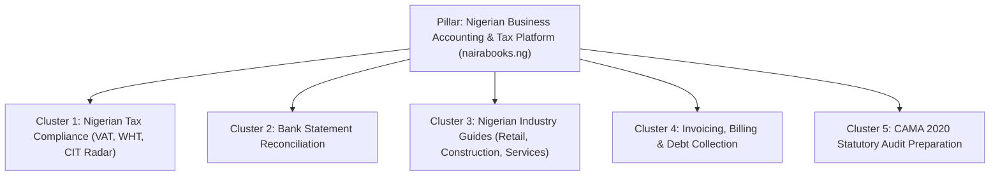

# NairaBooks 6-Month SEO Content & Growth Strategy (`docs/seo/SEO_CONTENT_PLAN.md`)

> **Comprehensive Organic Search Engine Strategy, Content Silos & Topical Authority Plan**  
> *Target Geo: Nigeria (Lagos, Abuja, Port Harcourt, Kano, Ibadan, Enugu) & West Africa*

---

## 1. Organic Search Objectives & KPIs

- **Month 3 Target:** 5,000 monthly organic unique visits; rank in Top 5 for 15 localized long-tail accounting keywords.
- **Month 6 Target:** 25,000 monthly organic visits; #1 ranking for "accounting software for Nigerian SMEs", "how to calculate VAT Nigeria 2025", and "reconcile Access Bank statement".
- **Conversion Goal:** 3.5% organic visit-to-free-trial signup rate across Nigerian SME decision-makers.

---

## 2. Topical Content Clusters & Silos

### Cluster 1: Nigerian Tax Compliance & FIRS / NRS Guidance
- **Pillar Article:** *The Ultimate Guide to Nigerian Business Accounting & Tax Compliance in 2025/2026* (`/guides/nigerian-tax-accounting-2025`)
- **Supporting Articles:**
  - *Understanding 7.5% VAT in Nigeria: What Every Small Business Needs to Know*
  - *Withholding Tax (WHT) in Nigeria: Rates, Credit Notes, and Offsets Explained*
  - *Nigeria Tax Act 2025: Are You Eligible for the 0% CIT Exemption?*
  - *Why Professional Services Are Excluded from Small Business Tax Holidays in Nigeria*

### Cluster 2: Nigerian Bank Statement Reconciliation
- **Pillar Article:** *How to Reconcile Nigerian Bank Statements in Under 5 Minutes*
- **Supporting Articles:**
  - *How to Download and Reconcile Access Bank Statement PDFs*
  - *Zenith Bank Corporate Statement Reconciliation: Common Traps and Solutions*
  - *Handling the ₦50 Electronic Money Transfer Levy (EMTL) in Double-Entry Books*

### Cluster 3: Vertical-Specific Accounting & Operations
- **Supporting Articles:**
  - *Accounting for Retail Stores in Lagos: POS Cash Flows and Stock Management*
  - *Construction Accounting in Nigeria: Job Costing, Subcontractors, and 5% WHT Retention*
  - *Non-Profit Fund Accounting in Nigeria: Managing Grants and Donor Restrictions*

---

## 3. Search Intent Mapping & Editorial Calendar

| Month | Content Piece | Target Keyword | Search Intent | Projected Traffic |
| :--- | :--- | :--- | :--- | :--- |
| **M1** | Ultimate Guide to Nigerian Tax & Accounting 2025 | "accounting in Nigeria" | Informational / Pillar | 2,500/mo |
| **M1** | Withholding Tax (WHT) Rates Nigeria Guide | "withholding tax rate in Nigeria" | Informational | 3,800/mo |
| **M2** | 7.5% VAT Calculation & Invoicing Guide | "how to calculate VAT in Nigeria" | Informational | 4,200/mo |
| **M2** | Best Accounting Software in Nigeria Comparison | "accounting software in Nigeria" | Commercial Investigation | 1,800/mo |
| **M3** | Access Bank PDF Statement Reconciliation Guide | "reconcile Access bank statement" | Informational / Utility | 1,200/mo |
| **M3** | Nigeria Tax Act 2025 Small Company Exemption | "tax act 2025 small company exemption" | Informational | 3,100/mo |
| **M4** | Retail POS & Inventory Accounting Playbook | "retail inventory management Nigeria" | Commercial | 950/mo |
| **M4** | Construction Job Costing & Retention Guide | "construction accounting Nigeria" | Commercial | 750/mo |
| **M5** | CAMA 2020 Statutory Audit Preparation Checklist | "CAMA 2020 audit requirements" | Informational / High Intent | 1,100/mo |
| **M6** | Non-Profit Fund Accounting & Donor Reporting | "NGO accounting in Nigeria" | Commercial | 600/mo |
